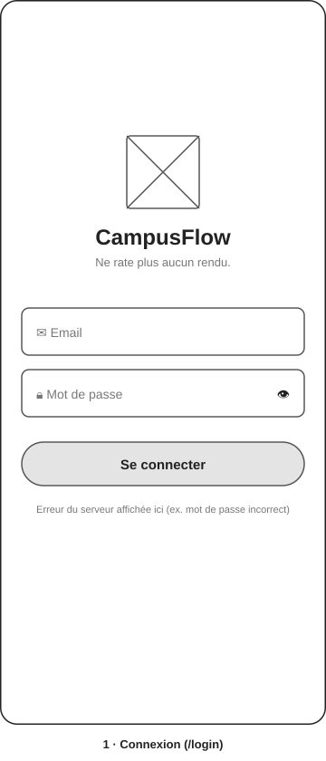
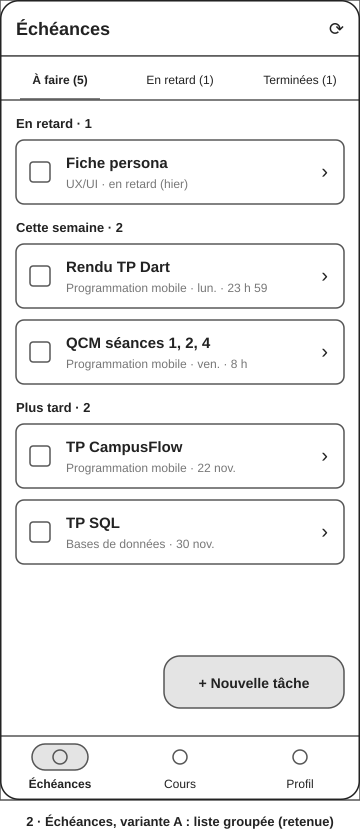
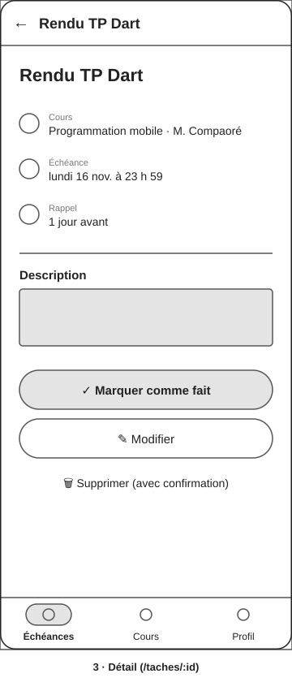
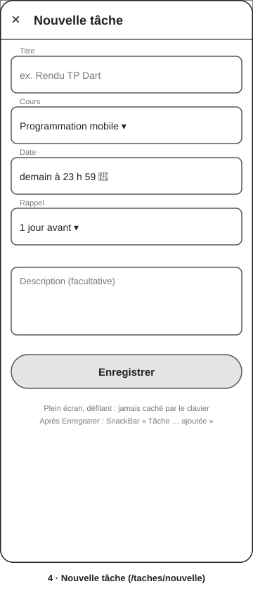
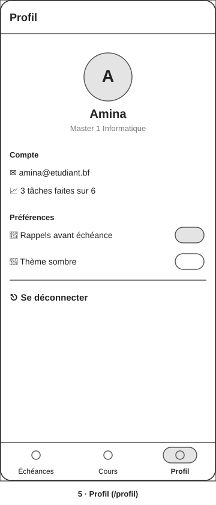
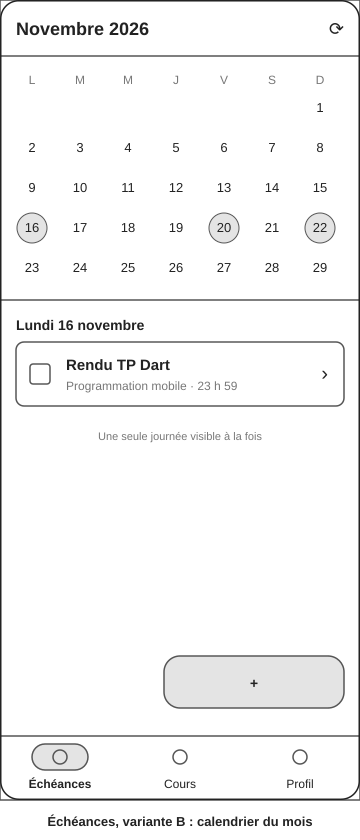
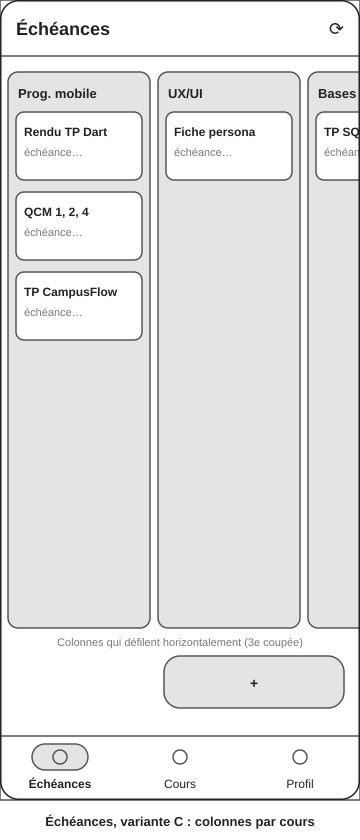

# Séance 2 · Wireframes de CampusFlow

Cinq écrans en **basse fidélité** (blocs, hiérarchie, sans couleur), sur un téléphone de référence de **360 × 800 dp**. Ils répondent à la question du niveau « wireframe » : *l'information est-elle bien placée ?*

## Les cinq écrans du parcours

| 1 · Connexion | 2 · Échéances | 3 · Détail |
|---|---|---|
|  |  |  |

| 4 · Nouvelle tâche | 5 · Profil |
|---|---|
|  |  |

**Plan de l'application** : Connexion → barre de navigation à trois destinations de même niveau (Échéances · Cours · Profil). Depuis Échéances : Détail → Modifier, et le bouton flottant ouvre Nouvelle tâche. L'écran Cours (liste des cours → tâches d'un cours) reprend la carte de tâche de l'écran Échéances.

## Trois variantes de l'écran Échéances

L'écran Échéances porte la job story principale (« voir ce qui est dû cette semaine »). C'est donc lui qui a été exploré en trois variantes.

| A · Liste groupée | B · Calendrier du mois | C · Colonnes par cours |
|---|---|---|
|  |  |  |
| Groupes En retard / Cette semaine / Plus tard, onglets de filtre | Mois en haut, tâches du jour sélectionné en dessous | Une colonne par cours, défilement horizontal |

## Choix justifié avec la grille du cours

| Question de la grille | A · Liste groupée | B · Calendrier | C · Par cours |
|---|---|---|---|
| **Besoin** : répond-elle à la job story « voir ce qui est dû cette semaine » ? | ✅ La semaine est visible dès l'ouverture, les retards en tête | ⚠️ Il faut toucher chaque jour pour voir ses tâches | ❌ Les échéances de la semaine sont dispersées entre colonnes |
| **Parcours** : est-il le plus court ? | ✅ 0 appui pour voir, 3 pour ajouter | ⚠️ 1 appui par jour consulté | ⚠️ Défilement horizontal pour voir tous les cours |
| **Accessibilité** : contraste, cibles, libellés | ✅ Cartes pleine largeur, cibles de 48 dp, lecture verticale simple au lecteur d'écran | ⚠️ Pastilles de jour d'environ 30 dp, sous la cible de 48 dp | ❌ Colonnes étroites (texte tronqué à 360 dp), lecture difficile au lecteur d'écran |
| **Faisabilité en Flutter** | ✅ `ListView.builder` + `ListTile` + `TabBar` | ⚠️ Grille calendrier à construire ou paquet externe | ⚠️ `ListView` horizontal de colonnes, fragile à petite taille |
| **Cohérence avec le design system** | ✅ Réutilise la carte de tâche | ⚠️ Nouveau composant calendrier | ⚠️ Nouveau composant colonne |

**Décision : variante A, la liste groupée.** C'est la seule qui répond à la job story sans aucun appui, qui respecte la cible de 48 dp et qui se construit avec des widgets standard. La vue par cours (variante C) n'est pas abandonnée : elle existe sous forme d'écran séparé, l'onglet **Cours**, où chaque cours ouvre la liste de ses tâches. Le calendrier (variante B) pourra être reconsidéré si les étudiants le demandent, par exemple pour les examens.

Ces variantes ont été explorées comme le propose le cours (cadrer → explorer → critiquer → fixer). La grille a servi à décider : la proposition retenue est celle qui sert le persona, pas la plus originale.
